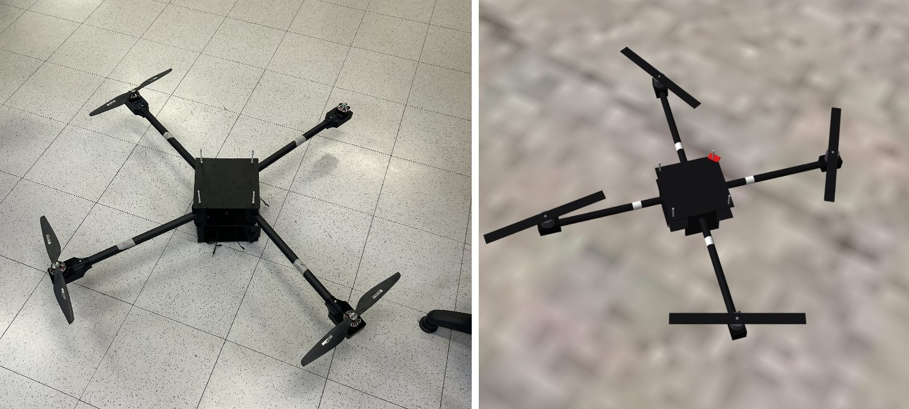
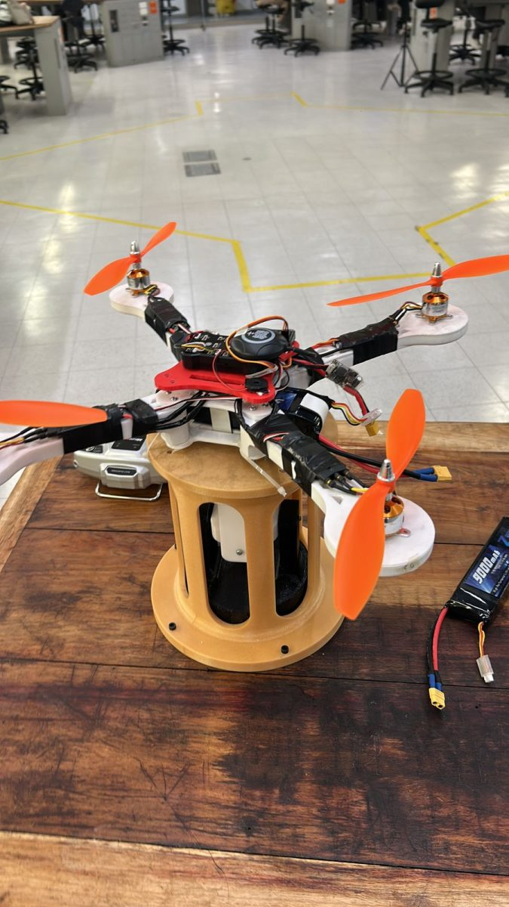
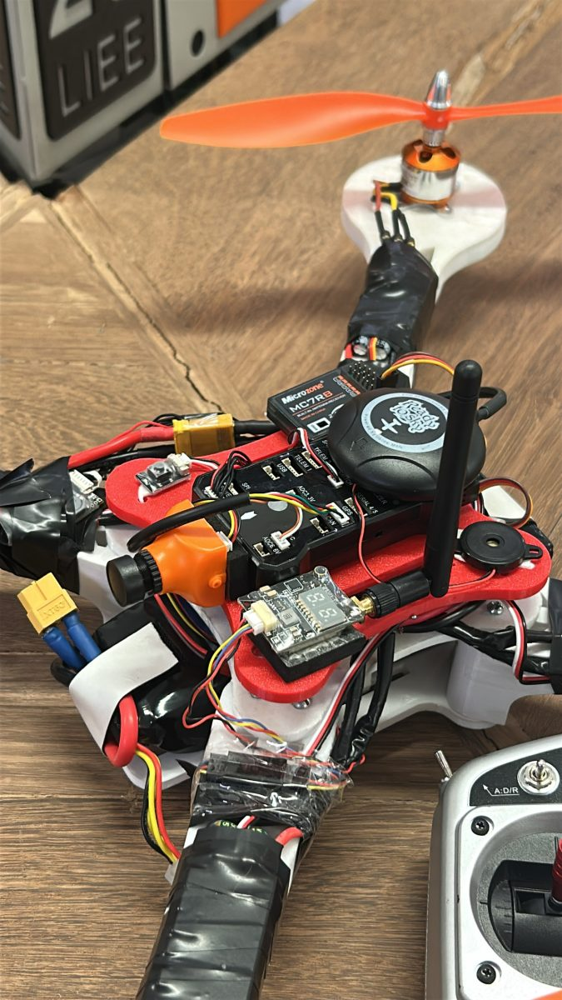
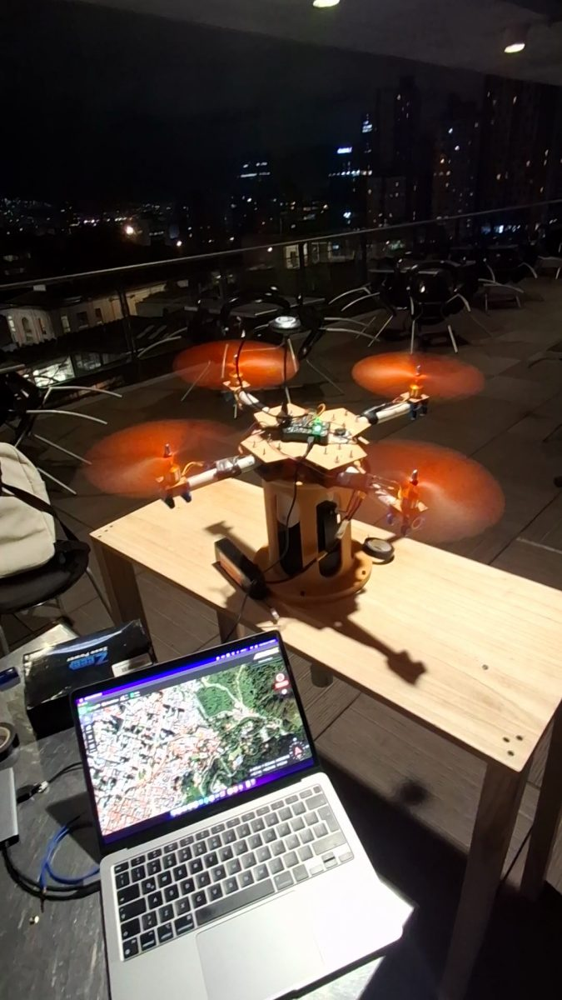
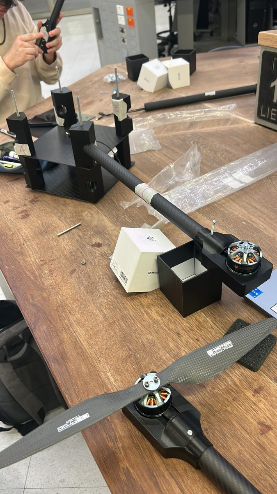
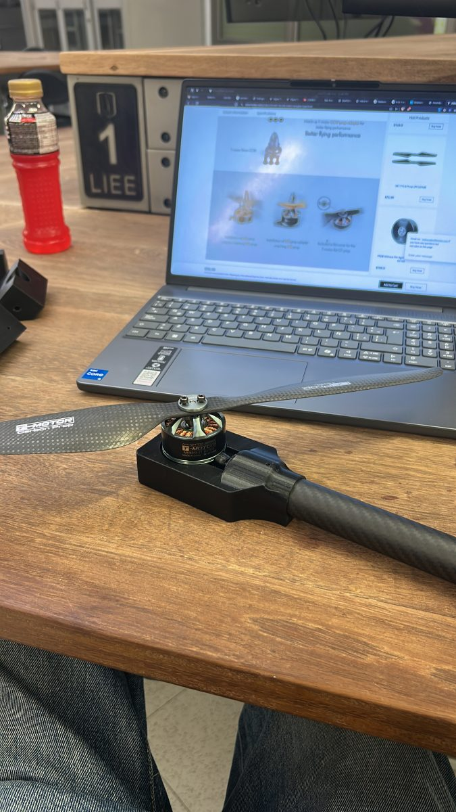
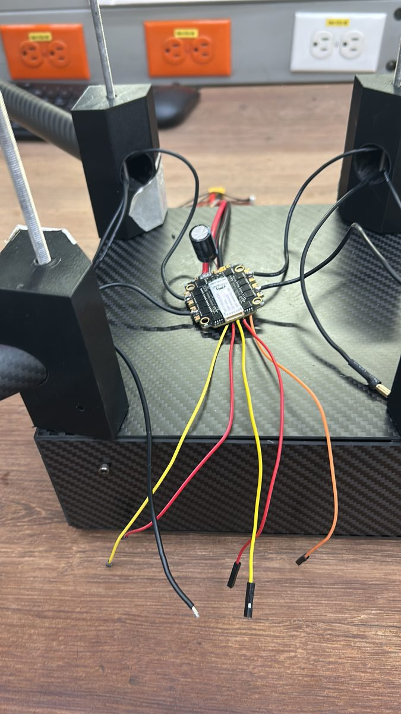
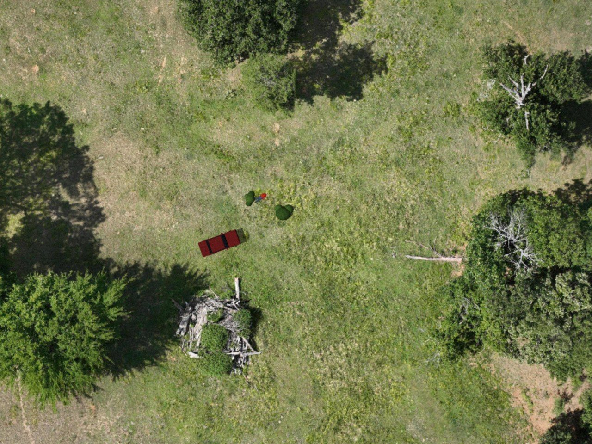
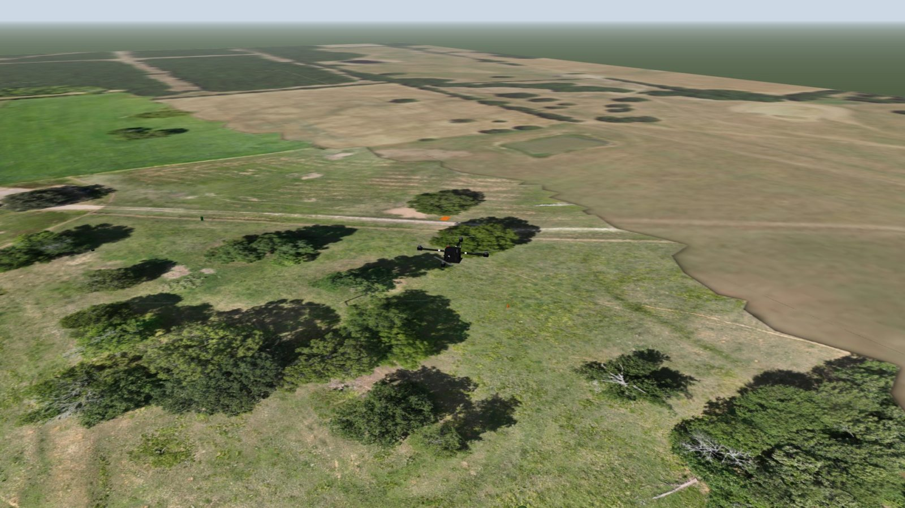

# Robocol SUAS 2026: the drone, recreated in simulation

> 📖 **Extended documentation:** [portfolio project page](https://portafolio-tau-indol-76.vercel.app/en/proyectos/robocol)
> ([en español](https://portafolio-tau-indol-76.vercel.app/es/proyectos/robocol))

A simulation of the quadcopter that team **Robocol** built for the **SUAS 2026** competition (Student Unmanned Aerial
Systems), running the same flight software the real drone would use: **ArduPilot** as the autopilot, missions in
**Python (DroneKit)** and physics in **MuJoCo**. The drone flies with wind, noisy sensors and a camera that sees real
aerial imagery, so the mission and the vision pipeline can be tested before a drone is in the air.

<p align="center">
  <br>
  <em>The real drone (left) and its reconstruction in MuJoCo (right).</em>
</p>

## Background

Robocol (Universidad de los Andes) designed and built two drones for SUAS 2026. First, a small **prototype** to test the
electronics, motors and autopilot on the test bench:

<table>
  <tr>
    <td></td>
    <td></td>
    <td></td>
  </tr>
  <tr>
    <td align="center"><em>Prototype on the test bench</em></td>
    <td align="center"><em>Its electronics: flight controller, receiver, GPS</em></td>
    <td align="center"><em>Motor test, with the ground station</em></td>
  </tr>
</table>

Then, the **final drone**: an X quadcopter measuring 1 m motor to motor, with carbon-fiber tubes, a two-level central box
and T-Motor MN4014 motors with carbon propellers:

<table>
  <tr>
    <td></td>
    <td></td>
    <td></td>
  </tr>
  <tr>
    <td align="center"><em>Assembling the arms and the box</em></td>
    <td align="center"><em>Arm with an MN4014 motor and propeller</em></td>
    <td align="center"><em>Central box with the electronics</em></td>
  </tr>
</table>

The final drone **never flew**: there were no permits to fly it in the country, and the code from that time was not kept.
This repository **rebuilds it from scratch**: the physical model comes from the team's photos and CAD, and the software is
the same kind of stack that would have been loaded on the drone.

## What the simulation does

- The drone **takes off, flies missions and lands** under ArduPilot, the same firmware that runs on a real Pixhawk.
- It flies over a **practice field with the SUAS 2026 rules** (altitudes, geofence, a mannequin and a tent as targets),
  on top of **drone imagery** of a real ranch at 5 cm per pixel.
- It has what every real flight has: **gusty wind**, air drag, **noisy sensors** and GPS error.
- Its **camera** points down and hands every frame to the vision code (YOLO), just like the drone's camera would.

<table>
  <tr>
    <td></td>
    <td></td>
  </tr>
  <tr>
    <td align="center"><em>What the camera sees at 46 m: real ground imagery, with a simulated mannequin, car and bushes</em></td>
    <td align="center"><em>The drone over the search area, in the 3D viewer</em></td>
  </tr>
</table>

## How it works

```
                     MAVLink (TCP 5760)
  mission (DroneKit) ◀─────────────────▶  ArduPilot SITL (the autopilot)
                                               │   ▲
                         PWM for the 4 motors  │   │  IMU, position, velocity, attitude
                         (UDP 9002)            ▼   │  (JSON)
                                    MuJoCo bridge (physics, wind, camera)
                                        │                   │
                                  camera frames      flight state (WebSocket 8765)
                                        ▼                   ▼
                                  vision.py (YOLO)     Foxglove and 3D viewer
```

**The loop, 1200 times per second:**

1. **ArduPilot**, compiled for a PC ("SITL", *Software In The Loop*), decides how hard to drive each motor and sends the PWM.
2. The **bridge** (`sim/puente_sitl.py`) turns the PWM into thrust, adds the wind force and advances the MuJoCo physics
   by one step (0.8 ms).
3. The bridge replies with where the drone ended up: what the IMU, GPS and barometer would measure.
4. ArduPilot does not continue until it gets the reply (*lockstep*), so the two never drift out of sync.

The **mission** never touches the motors: it talks to ArduPilot over MAVLink ("take off", "go to this point", "land"),
just as it would talk to a real Pixhawk. Change the connection, and the same code would fly the real drone.

| Part | What it does | Where |
|---|---|---|
| Autopilot | stabilizes the drone, follows commands, enforces the geofence | ArduPilot (ArduCopter 4.6), `params/` |
| Physics | the drone as a rigid body with 4 thrusts; gravity, ground contact | MuJoCo, `modelos/dron.xml` |
| Wind and sensors | mean wind + gusts (Dryden model), drag, GPS error; IMU, barometer and GPS noise | `sim/perturbaciones.py`, `params/sensores_reales.parm` |
| Field | where it flies: ground imagery, boundaries, search area, targets | `campo/rustyponds.py` |
| Camera | 1280×960 downward frame, with shadows and real-camera defects | `sim/camara.py` |
| Missions | the flight logic | `mision/` |
| Visualization | ground station (map, camera, plots) and 3D view | Foxglove, `viz/` |

More detail in [docs/simulacion.md](docs/simulacion.md) (in Spanish), including the classic reference-frame trap:
MuJoCo and ArduPilot measure the axes differently.

## How to run it

**Requirements:** [Docker](https://www.docker.com/) (on a Mac, Docker Desktop must be open). For the 3D viewer, also
Python 3 on the host with `pip install mujoco websockets numpy opencv-python`.

### 1. Install (once)

```bash
git clone https://github.com/jor334/drone-robocol-recap.git && cd drone-robocol-recap
docker compose up -d --build        # builds the image: Ubuntu 24.04 + ArduPilot (slow: it compiles ArduPilot)
```

### 2. Run

It uses three terminals:

| Terminal | Commands | What you should see |
|---|---|---|
| **1. Simulation** | `docker compose exec suas bash`<br>`scripts/simular.sh` | The first time it downloads the ground imagery (~70 MB). Then `[puente] ArduPilot conectado ... a 1200 Hz` and `[geocerca] Lista`. Wait ~30 s for ArduPilot to get a GPS fix. |
| **2. Mission** | `docker compose exec suas bash`<br>`python3 -m robocol_suas.mision.ver_blancos` | The drone climbs to 50 m, flies over the tent and the mannequin, comes back and lands. Also: `mision.despegue_basico`. |
| **3. 3D viewer** (optional) | `scripts/visor.sh` (on the host, **outside** Docker) | A window with the drone in flight, at 60 frames per second. |

**Foxglove** (the ground station): open [Foxglove](https://foxglove.dev/download), *Open connection → Foxglove
WebSocket → `ws://localhost:8765`*. The first time, load the layout: *Layout → Import from file →
`foxglove/robocol_suas.json`*. It shows the map, the drone camera, a 3D view and plots of altitude, attitude and motors.

**Stop:** `Ctrl+C` in terminal 1.

### Options

They go after `scripts/simular.sh`:

| Option | What it does |
|---|---|
| `--viento 8,200` | 8 m/s wind coming from 200° (default `4,180`: 4 m/s from the south). `--viento 0,0` = no wind |
| `--turbulencia moderada` | gusts: `ninguna` (none), `ligera` (light, default), `moderada` (moderate), `fuerte` (strong) |
| `--error-gps 1.5` | typical GPS error in meters (default 1) |
| `--camara-ideal` | frames without noise, vignetting or blur |
| `--sin-camara` / `--resolucion 640x480` | if the computer cannot keep up with real time |

### Tests

```bash
docker compose exec suas python3 -m pytest tests
```

If something fails, see *Problemas comunes* (common problems) in [docs/simulacion.md](docs/simulacion.md).

## Layout

```
robocol_suas_ws/
├── README.md, docs/            this file and the details of each part (docs/imagenes: README images)
├── scripts/                    simular.sh (full simulation), visor.sh (3D viewer)
├── params/                     ArduPilot parameters: the drone, the geofence, sensor noise
├── foxglove/                   Foxglove layout
├── docker/, compose.yaml       the environment (Ubuntu 24.04 + ArduPilot + Python)
├── tests/                      automated tests
├── datos/                      (not in the repo) downloaded imagery, generated scene, ArduPilot logs
└── robocol_suas/
    ├── campo/                  where it flies: the field, the SUAS 2026 rules, the scene, the geofence
    ├── modelos/                the drone and the targets in MuJoCo (XML)
    ├── sim/                    the ArduPilot ↔ MuJoCo bridge, wind, camera, reference frames
    ├── viz/                    Foxglove and the 3D viewer
    ├── mision/                 the missions (DroneKit)
    └── vision.py               target detection: every camera frame comes in here
```

The code, comments and the documents in `docs/` are in Spanish.

## Status

**Working and measured:**
- It takes off, flies and lands in real time: `despegue_basico` returns to its starting point within 0.4 m, with wind
  and GPS error.
- In 4 m/s of wind it tilts 6.3° ±0.6° to hold position at 50 m.
- The geofence works: ArduPilot rejects destinations outside the field and, if the drone leaves it, it returns and lands
  on its own.
- The camera delivers 3-6 frames per second; at 46 m it sees 5.5 cm per pixel (the mannequin covers ~32 pixels).

**Worth knowing:**
- It is a **recreation**: the real drone never flew, so the simulation has not been compared against real flights.
- The mass (4.5 kg), the propellers and the drag coefficients are **estimates** ([docs/dron.md](docs/dron.md)).
- The field is a **practice** field: SUAS 2026 rules on a ranch in Texas, because the only public imagery of the official
  field (Tulsa) is 68 cm per pixel, useless for testing vision ([docs/campo.md](docs/campo.md)).
- The targets (mannequin, tent) are simple shapes, not realistic models.

## Documentation (in Spanish)

| | |
|---|---|
| [docs/simulacion.md](docs/simulacion.md) | the bridge, lockstep, reference frames, Foxglove, ports, common problems |
| [docs/campo.md](docs/campo.md) | the practice field, the SUAS 2026 rules, the geofence and the targets |
| [docs/realismo.md](docs/realismo.md) | camera, wind, sensor noise, 3D viewer |
| [docs/dron.md](docs/dron.md) | the drone in MuJoCo: where each number comes from, what is estimated, control tuning |

## Credits

- Team **Robocol**: design and construction of the prototype and the final drone (photos in this README).
- Drone imagery of the field: "RustyPonds", by CM, on [OpenAerialMap](https://map.openaerialmap.org), licensed
  [CC-BY 4.0](https://creativecommons.org/licenses/by/4.0/). Surroundings: USDA NAIP (public domain).
